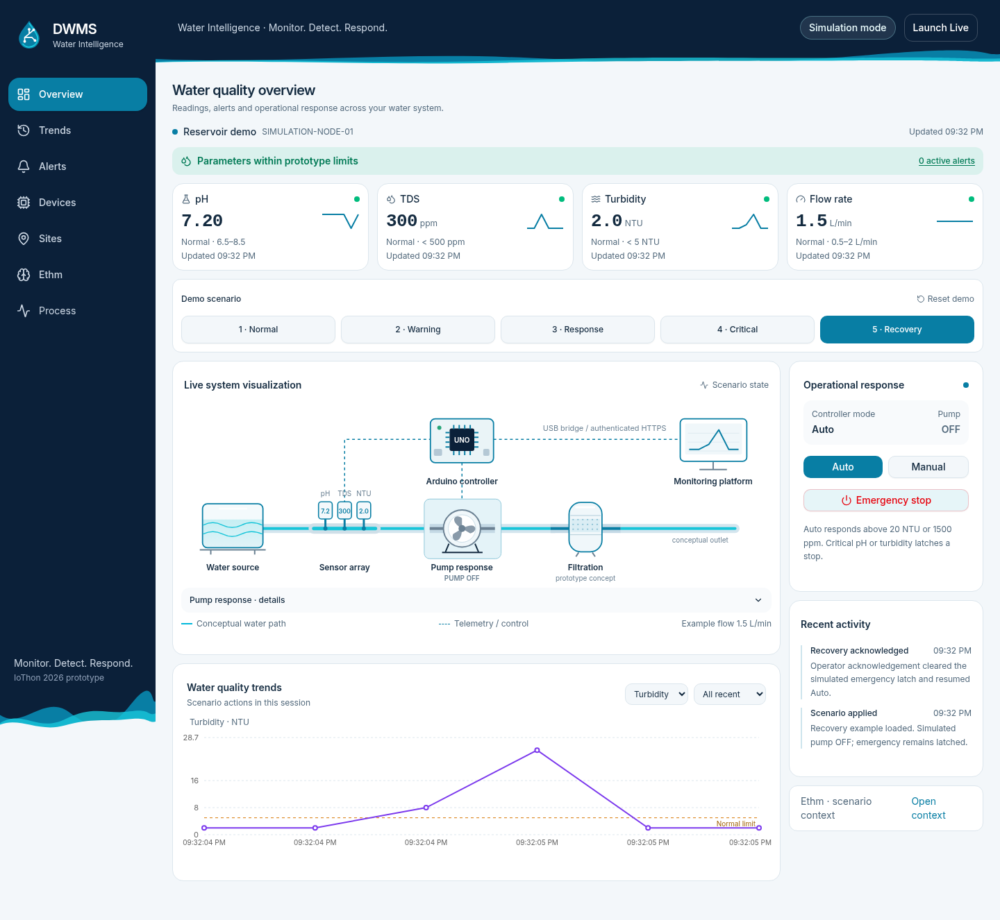

# DWMS · Water Intelligence

**Monitor. Detect. Respond.**

A focused IoThon 2026 prototype for water-quality monitoring across networks, reservoirs and treated-water reuse. DWMS brings pH, TDS and turbidity readings, data freshness, threshold alerts and traceable response into one workflow. Flow is demo-only.

| Component | Purpose | Current boundary |
|---|---|---|
| **Live** | Authenticated readings, alerts, history and authorized device controls | Existing cloud source/allowed Auth0 URLs need update and end-to-end rehearsal |
| **Demo** | Shared browser scenarios for a repeatable presentation | Synthetic readings and response; no physical action |
| **Hardware** | Arduino/USB bridge and deterministic local interlocks | Owner reports an earlier operating prototype; it is currently unavailable for audited revalidation |
| **Ethm** | Read-only explanation of authenticated device evidence | Real provider/data/model operation is pending; no fabricated replies or actuation |

Competition implementation: [improvement branch](https://github.com/ethm09/DWMS-IoThon-2026/tree/improve/iothon-2026-focus) · [Draft PR #2](https://github.com/ethm09/DWMS-IoThon-2026/pull/2). Main is unchanged pending approval.

**[Open the software demo](https://dwms-iothon-competition-demo.merryllama4097.chatgpt.site)** · [Readiness and evidence](docs/VALIDATION.md) · [Demo runbook](docs/DEMO.md)



Actual application screenshot using synthetic browser values; no physical output is connected.

## Run locally

Use Node.js 24 and pnpm 10:

```bash
pnpm install --frozen-lockfile
pnpm dev
```

Choose Simulation for the public browser demonstration. It requires no login, changes no physical output and does not write device history. Connected operation uses the existing React/TypeScript + Convex architecture with Auth0 identities and a Python/USB Arduino bridge; see [setup](docs/SETUP.md).

```bash
pnpm test
pnpm demo:e2e
pnpm lint
pnpm build
```

The integration runner uses a disposable local backend with synthetic readings/operator/ACKs. CI and Uno compilation are software evidence. No audited physical measurements from the earlier prototype were supplied; current repository calibration/relay gates remain disabled. Use the [hardware reconnection guide](docs/HARDWARE.md) before commissioning. An ACK does not prove pump motion or water safety.

## Review the project

- [Architecture](docs/ARCHITECTURE.md): three physical channel design and acknowledged command path.
- [Single readiness record](docs/VALIDATION.md): Implemented, Software verified, Simulation verified, Physically validated, Pending and Blocked evidence; calibration and hardware information required.
- [Audit and priorities](docs/AUDIT.md): retained functionality and focused reliability changes.
- [Pilot and competitive context](docs/COMPETITION.md): proposed utilities-engineer pilot, primary-source competitors and feasibility.
- [English submission draft](deliverables/IoThon-Submission.md) · [100-second video storyboard](deliverables/Demo-Video-Storyboard.md).
- Pitch: [editable PPTX](deliverables/DWMS-Pitch.pptx) · [PDF](deliverables/DWMS-Pitch.pdf). Feasibility: [editable DOCX](deliverables/DWMS-Feasibility.docx) · [PDF](deliverables/DWMS-Feasibility.pdf).
- Actual application captures: [desktop](docs/screenshots/dashboard-desktop.png) · [mobile](docs/screenshots/dashboard-mobile.png).

Founder and Project Lead: **Ahmed Alzahrani**. Original contributor history and the [MIT license](LICENSE) are preserved. DWMS retains its formal expansion, Defense Water Monitoring System; Water Intelligence is the display brand.
