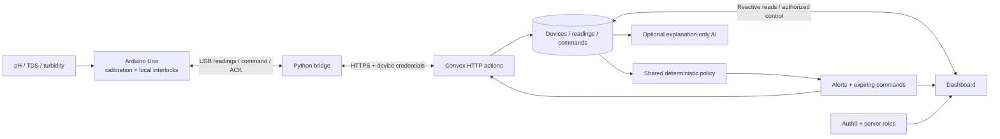

# System architecture

The existing Vite/React/TypeScript, Convex and Auth0 architecture is retained. Four components share it: **Live** authenticated `/live` monitoring/control, **Demo** synthetic `/demo` browser state, **Hardware** acquisition/bridge/local interlocks, and **Ethm** read-only explanation of authenticated evidence.

The current physical acquisition interface has three channels: pH, TDS and turbidity. Flow is demo-only. The owner reports an earlier operating prototype, currently unavailable; the checked-in calibration-disabled template is not proof of its measurements or a substitute for recovering that setup. See [HARDWARE.md](HARDWARE.md). Upgraded gateways send a session ID, monotonic packet sequence and gateway observation UTC, with optional controller sequence/uptime. The backend stores observation time and receipt separately; exact duplicate packets do not renew freshness, conflicting/replayed/out-of-order/over-10-second delayed/future packets are rejected, and legacy receipt-only downgrade is blocked after upgrade. Observation time is not probe acquisition UTC. Device IDs/locations and indexed histories underpin site views. Disconnection does not substitute demo values.

Rules are defined in [safetyPolicy.ts](../convex/safetyPolicy.ts): warnings precede critical bands; critical pH/turbidity latches OFF; Auto requests the prototype output for TDS >1500 ppm or turbidity >20 NTU. Explicit recovered acknowledgement is required. Commands expire after 20 seconds; desired output, ACK and independent physical output are different evidence.

Successful authenticated polls renew the Arduino's 15-second lease; sensor freshness is 5 seconds. Loss while operating latches OFF in software. USB retries cap at 10 seconds and delayed serial data is discarded. These configured durations are not measured stop latency.

The existing production backend now denies anonymous real-data reads, pump requests and agent runs. Operational reads additionally require an approved fleet grant or operator/admin role; new/legacy unapproved viewers are denied. Granted viewers cannot actuate. Private histories remain user-owned, while approved users share a fleet without per-site tenant isolation. Live Auth0 callback/session rehearsal remains blocked; Demo never initializes Auth0 and the hardware bridge is mounted only under `/live`. Legacy operational buffers are volatile per tab.

Ethm's real backend provider check returned HTTP 429 with `credit_balance_exhausted` / `provider_quota_exhausted`. It remains unavailable until usable provider credit and a successful model response are verified. No AI answer is inferred from a configured key.

See the [single evidence record](VALIDATION.md) and [demo runbook](DEMO.md). Ethm requires a real authenticated data/model path; no live AI response is established by a demo or a configured server key alone.
