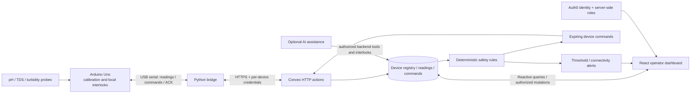

# System architecture

DWMS retains Vite, React, TypeScript, Convex and Auth0. No message broker or new application framework is required for the prototype.

## Data and response

1. The Arduino validates calibrated pH, TDS and turbidity before emitting JSON. Its conversion function currently returns `false`; enabling a flag alone does not complete calibration.
2. The bridge rejects malformed or uncalibrated readings. Convex authenticates the device and validates values before persisting a server receipt timestamp.
3. Rules evaluate the same configured thresholds used by the interface. A reading outside the normal band raises a warning before a critical condition. This is threshold detection, not a validated forecast.
4. Auto can request the prototype pump output for TDS >1500 ppm or turbidity >20 NTU. Critical pH (<5.5 or >10) or turbidity >50 NTU takes priority and latches Emergency OFF. Recovery requires fresh readings and operator acknowledgement.
5. Role-authorized controls create a command that expires after 20 seconds. The bridge sends it to the Arduino, which applies its local interlocks and returns an acknowledgement. The UI distinguishes desired output, acknowledgement and unknown state.

The pump rule is a demonstration policy. High TDS does not establish that a particular filter can remove dissolved solids. A site must select a suitable treatment/control action and validate it before operational use.

## Freshness and failure boundaries

- Hardware mode keeps the selected device source during disconnection; it does not replace missing data with demo values.
- A recent server receipt is connectivity evidence, not proof of probe accuracy or acquisition time.
- There is no acquisition timestamp, sequence number or replay protection in the current telemetry schema. Do not replay buffered samples as fresh measurements.
- Backend stop requests cannot stop an isolated controller. Local sensor interlocks and the communication watchdog are the relevant software protections during communication loss; their physical effect needs bench validation.
- The bridge sends `KEEPALIVE` only after a successful authenticated control poll. The Arduino requires that lease to start, and latches OFF after its configured 15-second lease or 5-second sensor freshness limit expires. These are software settings, not measured stop times. USB open failures retry with backoff capped at 10 seconds; delayed serial frames are discarded rather than uploaded as fresh samples.
- Controller software state cannot prove relay contacts opened, a pump stopped, or treatment succeeded.

## Access and scale

Device API keys protect ingestion and bridge control. Auth0 identities map to server-side viewer/operator/admin roles; credential redaction and backend checks protect controls. Do not expose credentials in screenshots or commit deployment secrets.

The existing device registry and reading queries remain publicly readable through the backend API even though connected UI pages request sign-in. Device keys are redacted, but locations and telemetry have no tenant/site isolation. Restrict these queries and add site authorization before using sensitive deployment data.

Each device has an ID, location, command history and indexed sensor history. The Sites view uses registered devices rather than invented site statistics. This supports a multi-node prototype, not an established fleet capacity: retention, query bounds, notification fanout, credential lifecycle and tenant/site authorization need review and measured load tests before a larger deployment.

Browser simulation is separate from persisted telemetry. Shared thresholds and scenario response can be demonstrated without deploying a backend. AI, local activity logs and browser storage are not authoritative physical evidence.
