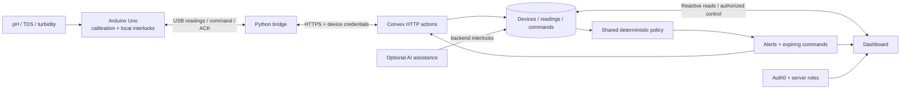

# System architecture

The existing Vite/React/TypeScript, Convex and Auth0 architecture is retained.

The backend validates complete pH/TDS/turbidity samples and records server receipt time. Device IDs/locations and indexed histories underpin registered-site views. The dashboard distinguishes current, stale and unknown data; disconnection does not substitute demo values.

Rules are defined in [safetyPolicy.ts](../convex/safetyPolicy.ts): warnings precede critical bands; critical pH/turbidity latches OFF; Auto requests the prototype output for TDS >1500 ppm or turbidity >20 NTU. Explicit recovered acknowledgement is required. Commands expire after 20 seconds; desired output, ACK and independent physical output are different evidence.

Successful authenticated polls renew the Arduino's 15-second lease; sensor freshness is 5 seconds. Loss while operating latches OFF in software. USB retries cap at 10 seconds and delayed serial data is discarded. These configured durations are not measured stop latency.

Auth0 roles protect operator controls; per-device keys protect bridge endpoints and are redacted from listings. Registry/history API queries remain public and lack tenant isolation. Retention, notification fanout and larger-fleet capacity are unvalidated.

See the [readiness checklist](VALIDATION.md) for evidence, calibration and physical gates; the [runbook](DEMO.md) distinguishes simulation from an actual probe-to-output trace.
