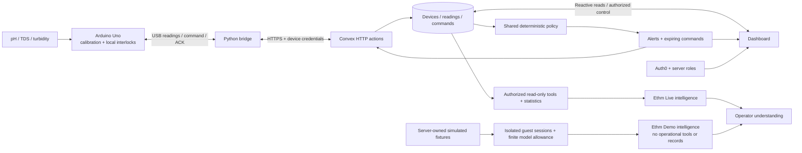

# System architecture

The existing Vite/React/TypeScript, Convex and Auth0 architecture is retained. Four components share it: **Live** authenticated `/live` monitoring/control, **Demo** synthetic `/demo` browser state, **Hardware** acquisition/bridge/local interlocks, and **Ethm**, the Water Intelligence Engine: evidence-based statistical assessment, bilingual contextual AI and analytical reporting. Its Live and guest Demo contexts are separate; independent deterministic controls enforce equipment safety.

The current physical acquisition interface has three channels: pH, TDS and turbidity. Flow is demo-only. The owner reports an earlier operating prototype, currently unavailable; the checked-in calibration-disabled template is not proof of its measurements or a substitute for recovering that setup. See [HARDWARE.md](HARDWARE.md). Upgraded gateways send a session ID, monotonic packet sequence and gateway observation UTC, with optional controller sequence/uptime. The backend stores observation time and receipt separately; exact duplicate packets do not renew freshness, conflicting/replayed/out-of-order/over-10-second delayed/future packets are rejected, and legacy receipt-only downgrade is blocked after upgrade. Observation time is not probe acquisition UTC. Device IDs/locations and indexed histories underpin site views. Disconnection does not substitute demo values.

Rules are defined in [safetyPolicy.ts](../convex/safetyPolicy.ts): warnings precede critical bands; critical pH/turbidity latches OFF; Auto requests the prototype output for TDS >1500 ppm or turbidity >20 NTU. Explicit recovered acknowledgement is required. Commands expire after 20 seconds; desired output, ACK and independent physical output are different evidence.

Successful authenticated polls renew the Arduino's 15-second lease; sensor freshness is 5 seconds. Loss while operating latches OFF in software. USB retries cap at 10 seconds and delayed serial data is discarded. These configured durations are not measured stop latency.

The existing production backend now denies anonymous real-data reads, pump requests and agent runs. Operational reads additionally require an approved fleet grant or operator/admin role; new/legacy unapproved viewers are denied. Granted viewers cannot actuate. Private histories remain user-owned, while approved users share a fleet without per-site tenant isolation. Published Auth0 callback/logout/origin protocol checks pass; real-session acceptance remains blocked by unavailable secure browser control; Demo never initializes Auth0 and the hardware bridge is mounted only under `/live`. Legacy operational buffers are volatile per tab.

Ethm uses the existing backend-only OpenAI integration. Live model requests load the authenticated user's saved history and authorized device tools. Guest requests use server-reconstructed scenario fixtures and separate `demoEthmSessions`/`demoEthmBudgets` tables; no operational database functions or actuator tools are available. Replies are genuine model interpretations, distinct from deterministic facts and source measurements. The reviewed reference whitelist provides context and citations, not a site-specific regulatory certificate.

Local statistical rules flag significant changes, sampled repeated threshold episodes, possible channel/maintenance issues and data freshness. Experimental short-horizon OLS estimates require at least 20 distinct valid samples across 5 minutes, current valid data and a suitable sampling/model window. Uncertainty reflects model residuals, not probe accuracy or future process changes. No field predictive accuracy or anticipation capability is claimed. Sparse Demo sequences show insufficient data. PDF/CSV reports identify source, estimates, unavailable channels and partial loaded-window coverage; report generation makes no model request.

Public AI is deliberately bounded: opaque session capabilities are hashed server-side; strict request size/context/output limits, minute throttles, session quotas and a non-resetting lifetime token reservation apply. Model failures and chat clearing do not refund reservations. This bounds the application model-token allowance; CORS is not bot authentication and the allowance does not cap hosting/platform invoices under arbitrary traffic. See [SETUP.md](SETUP.md) for the exact release limits. The shared public allowance can be exhausted; the deterministic demonstration remains usable.
