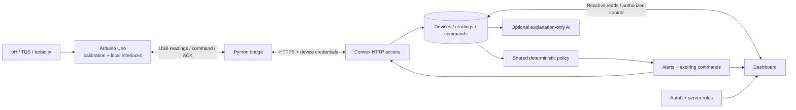

# System architecture

The existing Vite/React/TypeScript, Convex and Auth0 architecture is retained. Four components share it: **Live** authenticated monitoring/control, **Demo** synthetic browser state, **Hardware** acquisition/bridge/local interlocks, and **Ethm** read-only explanation of authenticated evidence.

The current physical acquisition interface has three channels: pH, TDS and turbidity. Flow is demo-only. The owner reports an earlier operating prototype, currently unavailable; the checked-in calibration-disabled template is not proof of its measurements or a substitute for recovering that setup. See [HARDWARE.md](HARDWARE.md). The backend records server receipt time; device IDs/locations and indexed histories underpin site views. Disconnection does not substitute demo values.

Rules are defined in [safetyPolicy.ts](../convex/safetyPolicy.ts): warnings precede critical bands; critical pH/turbidity latches OFF; Auto requests the prototype output for TDS >1500 ppm or turbidity >20 NTU. Explicit recovered acknowledgement is required. Commands expire after 20 seconds; desired output, ACK and independent physical output are different evidence.

Successful authenticated polls renew the Arduino's 15-second lease; sensor freshness is 5 seconds. Loss while operating latches OFF in software. USB retries cap at 10 seconds and delayed serial data is discarded. These configured durations are not measured stop latency.

Current source requires authenticated registered viewers/operators/admins to read the shared prototype fleet; guests and unregistered identities are denied. Roles protect controls; per-device keys protect bridge endpoints and are redacted from listings. Publishing these source changes to the existing cloud backend and testing real Auth0 sessions remain deployment gates. Site/tenant isolation, retention, notification fanout and larger-fleet capacity are unvalidated.

See the [single evidence record](VALIDATION.md) and [demo runbook](DEMO.md). Ethm requires a real authenticated data/model path; no live AI response is established by a demo or a configured server key alone.
